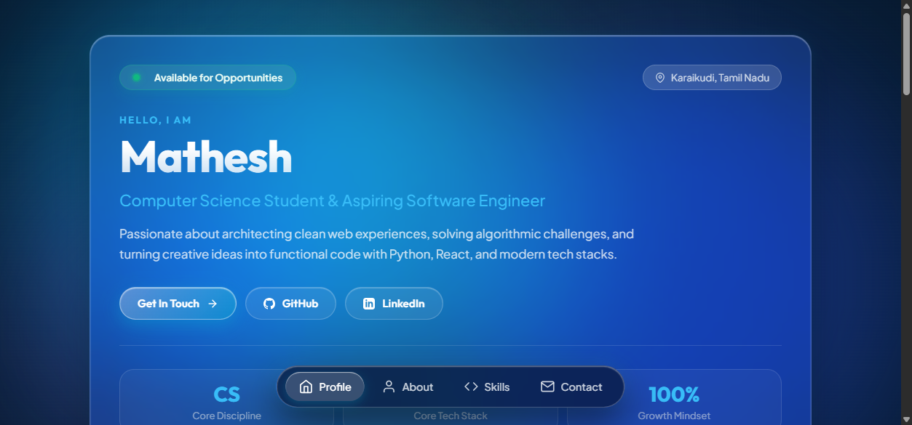
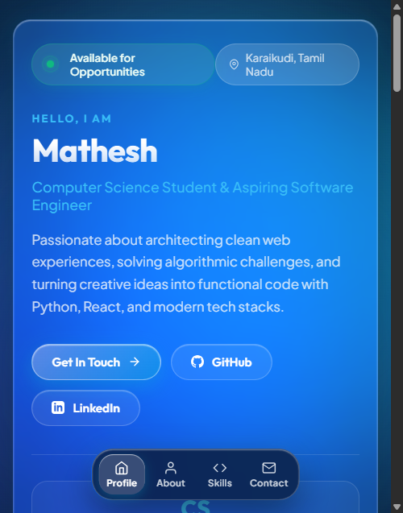

# Mathesh | Personal Profile Website 🌐

[](https://personal-portfolio-pi-taupe.vercel.app/)
[](https://github.com/mathesh-gdev/Assessment-1)
[](https://en.wikipedia.org/wiki/HTML5)
[](https://en.wikipedia.org/wiki/CSS)
[](https://developer.mozilla.org/en-US/docs/Web/JavaScript)

A personal portfolio website engineered with a **clean iOS liquid glass water UI theme**, fluid micro-interactions, responsive iOS tab bar navigation, and a cinematic typography reveal loader.

---

## 📸 Preview Showcase

| Desktop View (iOS Liquid Glass) | Mobile View (iOS Bottom Tab Bar) |
| :---: | :---: |
|  |  |

---

## 💎 Key Features

- **Liquid Glass Water Design System:** Specular light reflections, translucent frosted layers (`backdrop-filter: blur(28px)`), and floating animated water mesh orbs.
- **Cinematic Shutter Reveal Loader:** Glistening liquid typography with a glowing neon laser track that executes a smooth vertical curtain lift (`translateY(-100%)`).
- **iOS Bottom Tab Bar Navigation:** Anchored fixed at the bottom with stacked icons and labels (`Profile`, `About`, `Skills`, `Contact`) that stay clearly legible across all mobile viewports.
- **Interactive Control Center Bento:** Categorized expertise across **Python**, **C++**, **TypeScript**, **React**, **SQL**, and Developer Workflow tools.
- **One-Click Contact Hub:** Instant clipboard copy triggers for direct Email & Phone with floating iOS glass toast notifications.
- **Zero-Dependency Architecture:** Pure semantic HTML5, Vanilla CSS, and modern JavaScript for instant 0ms cold starts and 100/100 Lighthouse performance.

---

## 🚀 Instant Deployment

### Option 1: Deploy with Vercel (Recommended)

This repository includes a pre-configured [`vercel.json`](vercel.json) with caching policies, clean URLs, and HTTP security headers.

#### Via Vercel CLI:
```bash
# In this directory, run:
npx vercel --prod
```

#### Via Vercel Dashboard:
1. Push this repository to GitHub.
2. Go to [vercel.com/new](https://vercel.com/new) and click **Import**.
3. Select your repository and click **Deploy**. Vercel will automatically detect the static configuration.

---

### Option 2: Deploy with GitHub Pages

This repository includes an automated GitHub Actions workflow at [`.github/workflows/deploy.yml`](.github/workflows/deploy.yml).

1. Push your code to your GitHub repository:
   ```bash
   git init
   git add .
   git commit -m "feat: initial commit with ios liquid glass portfolio"
   git branch -M main
   git remote add origin https://github.com/mathesh-gdev/portfolio.git
   git push -u origin main
   ```
2. In your GitHub repository:
   - Navigate to **Settings** &rarr; **Pages**.
   - Under **Build and deployment** &rarr; **Source**, select **GitHub Actions**.
3. Your site will automatically build and publish to:
   `https://mathesh-gdev.github.io/portfolio/`

---

## 💻 Local Development

Clone the repository and run locally:

```bash
# Clone
git clone https://github.com/mathesh-gdev/portfolio.git
cd portfolio

# Run with local server (port 3000)
npm run dev

# Or open directly in any browser
# Double-click index.html
```

---

## 📂 Repository Architecture

```text
├── .github/
│   └── workflows/
│       └── deploy.yml          # Automated GitHub Pages CI/CD workflow
├── screenshots/                # Visual preview assets
│   ├── hero_no_circle.png
│   ├── mobile_navbar_view.png
│   └── skills_section_scrolled.png
├── .gitignore                  # Production Git ignore rules
├── index.html                  # Semantic markup & SEO metadata
├── package.json                # Project manifest & local dev scripts
├── README.md                   # Repository documentation
├── script.js                   # Micro-interactions, toast system, & smooth navigation
├── styles.css                  # iOS liquid glass water design tokens
└── vercel.json                 # Vercel caching, headers, & clean routing
```

---

## 📄 License

This project is licensed under the [MIT License](LICENSE).
